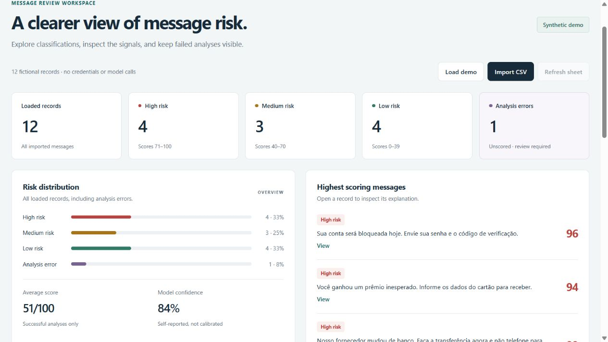
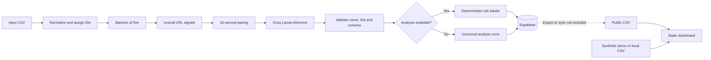
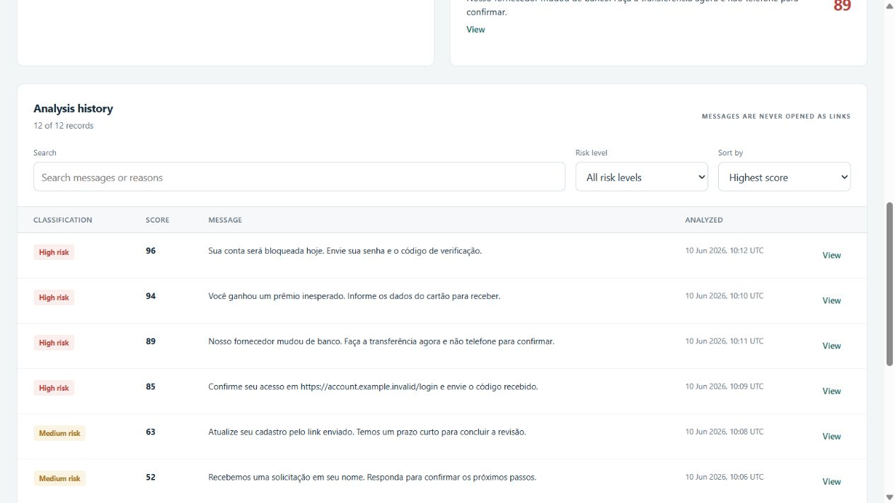

# AI-Powered Phishing Detection

An academic proof of concept combining **n8n, Groq/Llama, JavaScript and Supabase**, with a standalone review dashboard.

The workflow analyzes text; the dashboard explores saved classifications. The public demo uses fictional records and makes no model calls.



## 1. Project Overview

This project integrates lexical URL signals with LLM-based semantic analysis to support human review of potentially fraudulent messages. It focuses on orchestration, defensive validation, explainable triage and accessible presentation rather than training a new model.

## 2. Problem Statement

Suspicious messages may combine urgency, plausible context, credential requests and payment instructions. URL rules alone miss threats without links; an LLM alone can return malformed, inconsistent or misleading results. The prototype combines both approaches and explicitly separates unavailable analysis from a low-risk classification.

## 3. Technologies Used

| Component | Role |
| --- | --- |
| n8n | CSV ingestion, batches, rate pacing, inference and persistence |
| Groq / `llama-3.3-70b-versatile` | Semantic classification; model availability must be checked in the operator's account |
| JavaScript | URL signals, response validation, dashboard and CSV handling |
| Supabase / PostgreSQL | Server-side storage through the n8n credential manager |
| HTML / CSS | Static dashboard, with no build step or third-party frontend dependencies |
| Google Sheets | Optional, manually refreshed public CSV source for the dashboard |
| Node.js 22+ | Dependency-free local verification with the built-in test runner |

## 4. System Architecture



The dashboard is **not connected directly to Supabase**, does not run inference, and does not automatically receive newly inserted rows. Export/synchronization is outside this repository.

## 5. Workflow Explanation

Import [the inactive n8n workflow](workflow/phishing_detection_n8n.json). Twelve nodes preserve the original CSV → batch → URL analysis → Groq → validation → Supabase architecture.

- IDs are assigned before batching, so they do not reset at each iteration.
- Ground-truth labels are retained separately but excluded from `prompt_lote`, the model input.
- URL inspection is lexical: no message URL is opened or fetched.
- The chain is configured for up to three attempts; continued provider failures reach validation as errors.
- Validation matches results by ID, checks completeness and field types, and preserves the original message text rather than trusting a model echo.
- Parse/provider/schema failures produce `analysis_status=analysis_error`, null score/confidence/suspicion, and `ERRO DE ANALISE`.
- Storage errors stop the n8n execution. They are not silently converted into successful persistence.

Editable Code-node sources are in [workflow/code](workflow/code/). Run `node scripts/build-workflow.cjs` after editing them, then `npm run check` to verify synchronization with the JSON export.

## 6. Phishing Classification Method

The LLM considers message context, urgency, sensitive-information requests and auxiliary URL signals such as IP hosts, known shortener hosts and unusual TLDs. Those signals are weak indicators, not proof of maliciousness.

| Status | Score | Display |
| --- | --- | --- |
| `ok` | 0–39 | Low risk |
| `ok` | 40–70 | Medium risk |
| `ok` | 71–100 | High risk |
| `analysis_error` | null | Analysis error; human review required |

Scores and self-reported confidence are not calibrated probabilities. A valid zero remains low risk; missing or invalid scores never default to zero. Even a valid low score does not prove that a message is safe.

## 7. Dashboard Features

- Counts for loaded records, three risk bands and analysis errors.
- Distribution bars, mean score and self-reported model confidence; failed records are excluded from averages.
- Highest-scoring messages and a searchable, filterable, sortable history.
- Full message/explanation dialogs without turning suspicious URLs into clickable links.
- Local CSV import, bounded to 5 MB and 10,000 records, with quoted-field support.
- Pagination at 100 visible rows and clear empty/error states.
- Optional public Sheets CSV refresh; no JSONP or external-script execution.
- Responsive layout, keyboard controls, focus states and text labels alongside colors.



## 8. Installation and Configuration

The dashboard needs only a modern browser. The workflow needs an operator-provided n8n instance, Groq credentials and a dedicated Supabase test table. Nothing in this repository installs or changes those services.

Follow [the setup guide](docs/SETUP.md). Credentials belong in n8n's private credential manager, never in exported JSON or browser configuration. [The example SQL](data/schema.sql) is for a **new test table**, not a production migration.

The disk-reader node expects `/files/sample_phishing_messages.csv` inside the n8n runtime. Adjust it to an approved path, or replace ingestion if using an environment without local-file support. No Docker installation is required by this repository.

## 9. Running the Demo

Open `dashboard/index.html`, or serve that folder:

```bash
python -m http.server 8000 --directory dashboard
```

Visit `http://localhost:8000`. Twelve fictional records load automatically, including an analysis error. Try **Search**, **Risk level**, **Sort by** and **Import CSV**, using [demo_results.csv](dashboard/demo_results.csv). Local imports are processed in memory; this page does not upload them.

For GitHub Pages, a manual [deployment workflow](.github/workflows/deploy-dashboard.yml) verifies the project, then uploads only `dashboard/`. After approving publication, select **Settings → Pages → Source: GitHub Actions** and run it. A hosted deployment is not claimed until its deployment succeeds.

## 10. Experimental Results

The supplied June 2026 academic report describes functional execution and historical screenshots, not a labeled evaluation with measured precision, recall or F1. The dashboard's synthetic scores are interface fixtures, not benchmark results.

During portfolio preparation on 2026-11-10:

| Verification | Result |
| --- | --- |
| Automated tests | 17 passed, covering failure handling, ID mapping, label isolation, URL signals, CSV parsing and dashboard data logic |
| JSON/code integrity and syntax | Passed |
| Browser demo | Loaded 12 records: 4 high, 3 medium, 4 low, 1 error |
| Browser search/filter/sort/details | Checked with actual controls |
| Local CSV import | Five-row supplied fixture and three-row adversarial fixture worked |
| Hostile HTML and malformed CSV | Rendered as text; malformed input rejected while retaining previous data |
| Revised n8n runtime import, Groq inference, Supabase inserts | Not executed; no configured test instance or credentials used |

See [validation scope](docs/VALIDATION.md) and [differences from the report](docs/REPORT_COMPARISON.md). Offline tests emulate Code-node inputs; they do not replace an n8n runtime import or an end-to-end integration test.

## 11. Security Considerations

Read [security and privacy](docs/SECURITY.md) and the [publication review](docs/SECURITY_REVIEW.md). The original PDF and historical screenshots are retained privately, rather than publishing personal acknowledgments and historical dataset rows. Public screenshots were captured from the revised synthetic demo.

Messages remain untrusted data. The prompt is not a complete prompt-injection defense. The static demo contains no API keys, n8n credential references, Supabase endpoint or personal Sheets feed. Do not connect a public site to private messages or a service-role key.

## 12. Limitations

No trained classifier, calibrated confidence, accuracy benchmark, threat-reputation lookup, SPF/DKIM/DMARC validation, attachment sandbox, OCR, QR decoding, authentication or automatic incident response is implemented. The supplied sample inputs are synthetic and too small to establish model performance. The public dashboard is a presentation layer for already-scored records.

## 13. Future Improvements

Evaluate against independently labeled data with labels hidden from the model, test the revised export in a pinned n8n version, calibrate scores, log prompt/model versions across executions, and add an authenticated data-access layer with explicit retention and review policies. These are future tasks, not existing capabilities.

## 14. Academic Context

**Kauan Abegg, UFSC, 2026.** Developed as an academic proof of concept. The supplied report acknowledges tutor Maurício Konrath and Prof. Ricardo Felipe Custódio. The portfolio edition was revised with AI assistance; the author remains responsible for understanding and explaining the implementation.

The original architecture is retained. Security fixes, stricter data contracts, a redesigned demo, documentation and offline tests were added during preparation. [Report comparison](docs/REPORT_COMPARISON.md) records those changes. No regular master's enrollment, production adoption, business ROI, model training or legal-compliance certification is claimed.

No open-source license has been selected. Third-party services and models retain their own terms.
